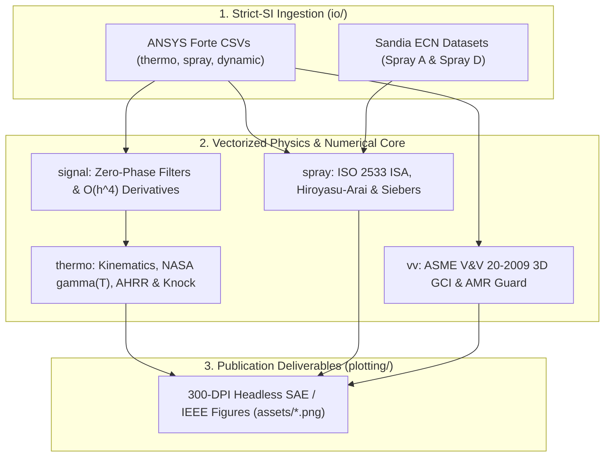
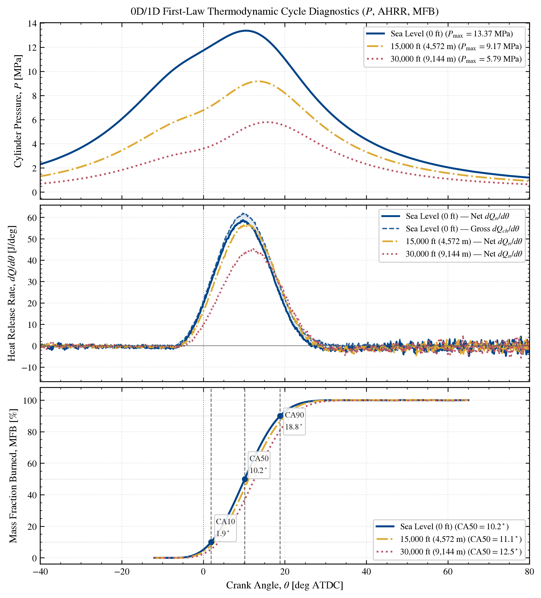
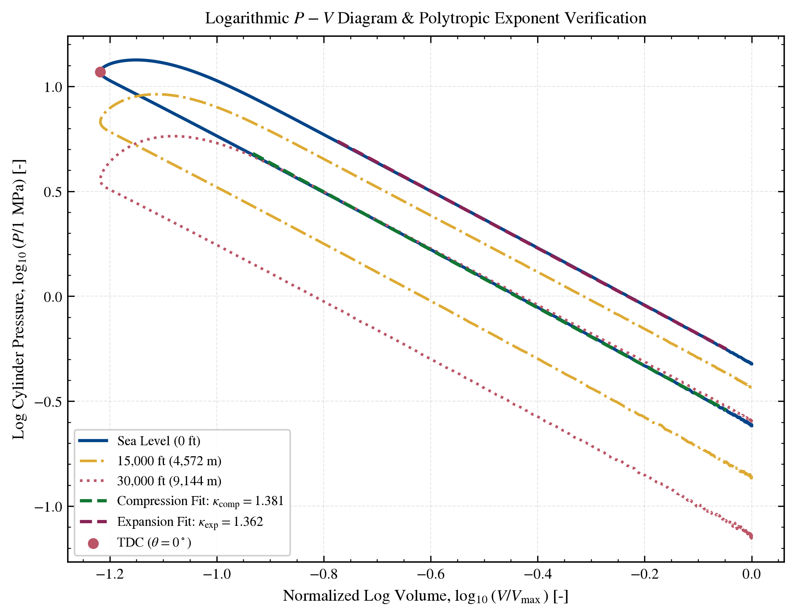
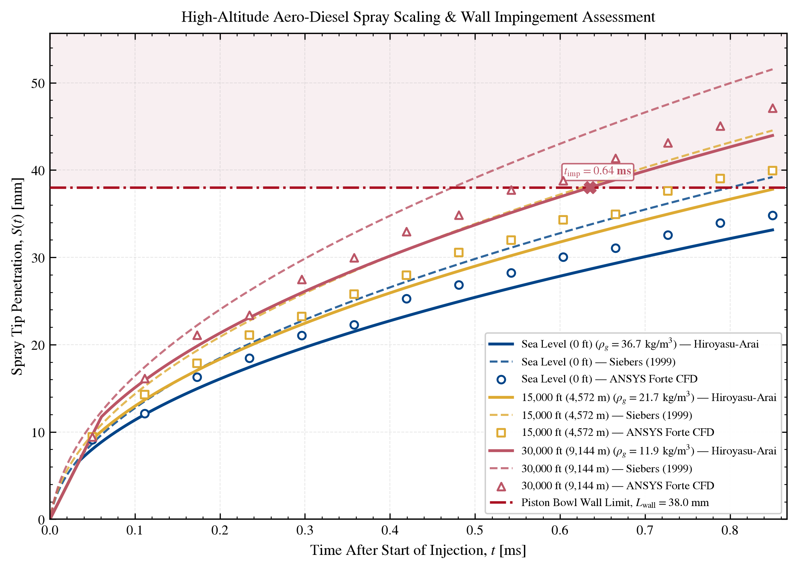
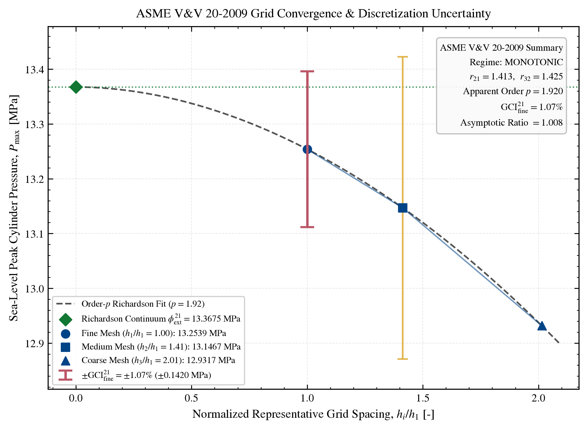

# `ice-cfd-validation-assistant`

[](https://github.com/alpztel/ice-cfd-validation-assistant/actions/workflows/ci_validation.yml)
[](pyproject.toml)
[](LICENSE)
[](#5-asme-vv-20-2009--celik-et-al-2008-grid-convergence-index-gci)
[](#4-iso-2533-standard-atmosphere--high-altitude-spray-scaling)
[](src/ice_cfd_validator/py.typed)
[](CITATION.cff)

**Open-source, strictly SI-normalized Python 3.11+ engineering toolkit for 0D/1D internal combustion engine (ICE) thermodynamic cycle diagnostics, high-altitude Aero-Diesel fuel-spray scaling, and ASME V&V 20-2009 3D CFD mesh-independence verification — purpose-built for [ANSYS Forte](https://www.ansys.com/products/fluids/ansys-forte) (`thermo.csv`, `spray.csv`, `dynamic.csv`) and [Sandia Engine Combustion Network (ECN)](https://ecn.sandia.gov/) datasets.**

[Overview](#exhaustive-capability-overview) • [Architecture](#package-architecture--strict-si-unit-engine) • [Theory](#mathematical--physical-formulations) • [Visual Showcase](#aero-diesel-high-altitude-showcase-0-ft--15000-ft--30000-ft) • [Complete API](#complete-public-api-reference) • [Code Recipes](#installation-quickstart--engineering-recipes) • [Verification Audit](#independent-verification--strict-physical-audit-39-tests) • [Structure](#repository-structure) • [Citation](#how-to-cite) • [References](#references) • [License](#license)

---

> [!IMPORTANT]
> **Strict NDA & Open-Science Guarantee:** This repository contains **zero** proprietary engine CAD geometries, OEM calibration maps, or restricted test-cell logs. Every test and showcase benchmark relies exclusively on closed-form analytical solutions (polytropic indicator loops, forward-ODE/inverse-AHRR Wiebe roundtrips, exact power-law grid convergence polynomials) and publicly documented Aero-Diesel / Sandia ECN correlations.

<details>
<summary><b>🇹🇷 Türkçe Kapsamlı Kütüphane Özeti — Bu Kütüphane Neler Yapabilir? (Genişletmek için tıklayın)</b></summary>

**`ice-cfd-validation-assistant`**, 3B içten yanmalı motor CFD simülasyonlarının (**ANSYS Forte**) ve deneysel sprey/yanma verilerinin (**Sandia ECN**) uluslararası akademik ve endüstriyel standartlara (**Heywood, SAE, ISO 2533, ASME V&V 20-2009**) göre doğrulanması (*Verification & Validation*) için geliştirilmiş, tam vektörize ve tip güvenli (`PEP 561` / `pyrefly`) bir Python mühendislik kütüphanesidir.

**Eksiksiz Yetenek Özeti:**
1. **Otomatik Birim Algılama ve Katı SI Normalizasyonu (`io/` & `constants.py`):**
   - ANSYS Forte `thermo.csv`, `spray.csv` ve `dynamic.csv` (1 satırlı veya 2 satırlı başlık yapıları) ile Sandia ECN (`Spray A` / `Spray D`, `.csv`/`.txt`/`.dat`, `#`/`%` yorum bloklu) dosyalarını otomatik okur.
   - `MPa`, `bar`, `dyne/cm^2` (CGS), `cm^3`, `mm`, `µm`, `ft`, `mg`, `ms`, `µs`, `degC` (afin dönüşüm: `+273.15 K`), `rad`, `kJ/CA`, `erg/CA` birimlerini türev ve integral öncesinde tam **SI birimlerine** (`Pa`, `m^3`, `m`, `kg`, `s`, `K`, `J/deg`) dönüştürerek $10^6$ mertebesindeki $P\,dV$ ölçekleme hatalarını kökten engeller.
2. **Sıfır Faz Kaymalı Sinyal İşleme ve 4. Mertebe Vektörize Türev (`signal/`):**
   - Savitzky–Golay (`savgol_zero_phase`) ve ileri-geri Butterworth (`butterworth_zero_phase`, `sosfiltfilt`) filtreleriyle gürültülü basınç izlerinde **yapay `CA50` faz kayması oluşturmadan** $dP/d\theta$ eldesi ve `4–20 kHz` vuruntu bandı izolasyonu.
   - Eşit aralıklı ağlarda döngüsüz 5 noktalı $\mathcal{O}(\Delta\theta^4)$ merkezi + Fornberg (1988) sınır şablonları; adaptif zaman adımlı (eşit olmayan) CFD çıktılarında analitik `CubicSpline` türevi (`compute_derivative`).
3. **Biyel-Krank Kinematiği ve Alt-Derece TDC Faz Denetimi (`thermo/kinematics.py`):**
   - Merkezi veya pim kaçıklıklı (*wrist-pin offset*, $e \neq 0$) biyel-krank mekanizması için anlık silindir hacmi $V(\theta)$, analitik hacim türevi $dV/d\theta$ (`rad → deg` Jakobyeni dahil) ve ısı transfer yüzey alanı $A_w(\theta)$ hesabı.
   - Ateşlemesiz (*motored*) çevrimde tepe basınç açısı ile geometrik ÜÖN ($\theta = 0^\circ$) arasındaki termodinamik kayıp açısını kübik spline kök bulucuyla denetleyen `verify_tdc_phasing` ($\pm 0.5^\circ$ CA tolerans kontrolü).
4. **NASA Glenn Polinomları, Duvar Isı Transferi, 1. Yasa AHRR, MFB, IMEP ve Vuruntu (`thermo/`):**
   - Sabit $\gamma$ kabulü yerine `200–6000 K` aralığında 14 katsayılı (iki sıcaklık bölgesi × 7 terim) **NASA RP-1311 / GRI-Mech 3.0** polinomlarıyla sıcaklığa bağlı $c_p(T)$, $c_v(T)$ ve $\gamma(T)$ (`DRY_AIR`, `DIESEL_BURNED_PRODUCTS`, `STOICHIOMETRIC_PRODUCTS` ve özel $\phi$, $H/C$ karışımları).
   - **Woschni (1967, SAE 670931)** ve **Hohenberg (1979, SAE 790825)** silindir içi taşınımla duvar ısı kaybı modelleri ($h_c(\theta)$, $dQ_{ht}/d\theta$).
   - **Heywood (2018) Termodinamiğin 1. Yasası** ile Görünür Net ($dQ_n/d\theta$) ve Brüt ($dQ_{\text{gross}}/d\theta$) Isı Yayılım Hızı, kübik spline antiderivatifleriyle kümülatif enerji, alt-derece hassasiyetli `CA10`, `CA50`, `CA90`, yanma süresi ($\Delta\theta_{10\text{–}90}$), Brüt/Net `IMEP`, `PMEP` ve **MAPO + Eng (2002) Ringing Intensity** ($RI$, `W/m²`) vuruntu analizi.
5. **ISO 2533 Atmosfer, Yüksek İrtifa Aero-Dizel Sprey Fiziği ve Cidar Islanması Denetimi (`constants.py` & `spray/`):**
   - **ISO 2533** Uluslararası Standart Atmosfer modeliyle `-500 m` ila `20,000 m` (`≈ 65,617 ft`) arasında troposfer + izotermal alt stratosfer $T_{\text{amb}}(z)$, $P_{\text{amb}}(z)$, $\rho_{\text{amb}}(z)$ ve ses hızı $a(z)$ hesabı.
   - $t = t_b$ kırılma anında tam $C^0$ sürekli **Hiroyasu & Arai (1990)** ve 5 adımlı vektörize Newton–Raphson ile makine hassasiyetinde çözülen **Naber & Siebers (1996) / Siebers (1999)** sprey penetrasyon modelleri.
   - İrtifa artışıyla düşen gaz yoğunluğunda ($\rho_g$) $(\rho_{g,1}/\rho_{g,2})^{0.25}$ aşırı penetrasyon ölçeklemesi, piston çanağı cidar çarpma başlangıç zamanı ($t_{\text{imp}}$) tespiti ve asenkron zaman serileri arasında `RMSE`, `MAPE`, bağıl $L_2$ ve $L_\infty$ doğrulama metrikleri.
6. **ASME V&V 20-2009 / Celik vd. (2008) 3B Ağ Yakınsama İndeksi ve AMR Koruması (`vv/gci.py`):**
   - 3B hücre sayısı veya ortalama hücre hacminden küpkök temsili ağ boyutu ($h_1 < h_2 < h_3$), $r < 1.3$ ASME standart uyarısı, eşit olmayan ağ oranları ($r_{21} \neq r_{32}$) için $q(p)$ transandantal sabit nokta / Brent çözücüsü ($\lvert p - g(p)\rvert \le 10^{-11}$), Richardson ekstrapolasyonu ($\phi_{\text{ext}}^{21}$), $GCI_{\mathrm{fine}}^{21}$ ve ANSYS Forte **Adaptif Ağ İyileştirme (AMR)** kaynaklı salınımlı yakınsamada ($\epsilon_{32}/\epsilon_{21} < 0$) `NaN` hatasını önleyen $s = \operatorname{sgn}(\epsilon_{32}/\epsilon_{21})$ koruması.
7. **300 DPI SAE / IEEE Akademik Görselleştirme (`plotting/`):**
   - Sunucu/CI uyumlu (*headless Agg*, sıfır `pyplot` bellek sızıntısı) STIX LaTeX tipografili 4 yayın kalitesinde grafik üreteci (`plot_thermo_diagnostics`, `plot_pv_log_diagram`, `plot_altitude_spray_comparison`, `plot_gci_convergence`).

</details>

---

## Table of Contents

1. [Exhaustive Capability Overview](#exhaustive-capability-overview)
2. [Package Architecture & Strict-SI Unit Engine](#package-architecture--strict-si-unit-engine)
3. [Mathematical & Physical Formulations](#mathematical--physical-formulations)
4. [Aero-Diesel High-Altitude Showcase (0 ft → 15,000 ft → 30,000 ft)](#aero-diesel-high-altitude-showcase-0-ft--15000-ft--30000-ft)
5. [Complete Public API Reference](#complete-public-api-reference)
6. [Installation, Quickstart & Engineering Recipes](#installation-quickstart--engineering-recipes)
7. [Independent Verification & Strict Physical Audit (39 Tests)](#independent-verification--strict-physical-audit-39-tests)
8. [Repository Structure](#repository-structure)
9. [How to Cite](#how-to-cite)
10. [References](#references)
11. [License](#license)

---

## Exhaustive Capability Overview

`ice-cfd-validation-assistant` eliminates ad-hoc spreadsheet macros and unit-fragile post-processing scripts across the entire 3D ICE CFD workflow. Every numerical routine is **loop-free (`numpy`/`scipy` vectorized)**, **immutable (`@dataclass(frozen=True, slots=True)`)**, and **statically type-checked (`pyrefly`)**.

### 1. Automated Unit-Safe CFD & Experimental Data Ingestion (`ice_cfd_validator.io`)
- **ANSYS Forte Monitor Parsers (`forte_parser.py`)**:
  - Automatically parses both **1-row inline-unit headers** (`Pressure [MPa]`, `Volume (cm^3)`) and **2-row ANSYS Forte headers** (variable name row + unit token row), handling UTF-8 BOMs (`utf-8-sig`), `#` comment lines, and Unicode superscripts/symbols (`cm³` → `cm^3`, `µm`/`μm` → `um`, `°C` → `C`).
  - `parse_thermo_csv`: Extracts crank angle ($\theta$ in both `deg` and `rad`), spatially averaged pressure ($P$ [`Pa`]), cylinder volume ($V$ [`m^3`]), mass-averaged temperature ($T$ [`K`]), simulation time ($t$ [`s`]), trapped mass ($m$ [`kg`]), and wall heat-loss rate ($dQ_{ht}/d\theta$ [`J/deg`]).
  - `parse_spray_csv`: Extracts elapsed time ($t$ [`s`]), liquid-phase penetration ($S_L$ [`m`]), vapor-phase penetration ($S_V$ [`m`]), droplet Sauter Mean Diameter ($D_{32}$ [`m`]), crank angle (`deg`/`rad`), and cumulative injected fuel mass ($m_{\text{inj}}$ [`kg`]).
  - `parse_dynamic_csv`: Extracts instantaneous active AMR cell count ($N_i$ [`-`]), crank angle (`deg`), time (`s`), mean cell volume ($\Delta V_{\text{mean}}$ [`m^3`]), and minimum AMR cell size ($\Delta x_{\min}$ [`m`]).
  - Enforces strict thermodynamic positivity bounds ($P > 0$, $V > 0$, $T > 0$, $m > 0$, $N_i > 0$) upon load and records raw unit strings in `.source_units` for audit traceability.
- **Sandia ECN Experimental Benchmark Loader (`ecn_loader.py`)**:
  - `load_ecn_spray_data`: Parses comma-delimited (`.csv`) and whitespace-delimited (`.txt`, `.dat`) **ECN Spray A / Spray D** tables with `#` or `%` metadata headers, automatically trims pre-SOI negative timestamps ($t < 0$), normalizes liquid and vapor penetration into meters, and preserves ensemble standard deviations ($\sigma_L, \sigma_V$ [`m`]) for ASME V&V 20-2009 experimental uncertainty ($u_D$) quantification.

### 2. Zero-Phase Signal Processing & $\mathcal{O}(\Delta\theta^4)$ Differentiation (`ice_cfd_validator.signal`)
- **Zero-Phase Savitzky–Golay Filtering (`savgol_zero_phase`)**: Symmetric local polynomial smoothing that suppresses high-frequency pressure transducer or CFD AMR noise while maintaining **zero group delay**, preventing artificial `CA50` combustion-phasing shifts.
- **Zero-Phase Forward–Backward Butterworth Filtering (`butterworth_zero_phase`)**: Second-order sections (`scipy.signal.sosfiltfilt`) low-pass, high-pass, and bandpass filtering with zero phase distortion and $2\times$ filter-order attenuation — used both for pressure conditioning and `4–20 kHz` acoustic knock isolation.
- **Hybrid 4th-Order / Cubic-Spline Differentiation (`compute_derivative`)**:
  - Automatically detects grid uniformity (`method="auto"`).
  - Evaluates exact vectorized **5-point $\mathcal{O}(\Delta\theta^4)$ central finite differences** on interior points paired with **5-point $\mathcal{O}(\Delta\theta^4)$ one-sided Fornberg (1988) boundary stencils** on uniform crank-angle grids.
  - Switches seamlessly to analytical first derivatives of **not-a-knot `CubicSpline`** interpolants on non-uniform adaptive time-step CFD outputs.

### 3. Slider-Crank Kinematics & Motored TDC Phasing Audit (`ice_cfd_validator.thermo.kinematics`)
- **Centered & Wrist-Pin-Offset Kinematics (`SliderCrankGeometry`)**:
  - Computes exact instantaneous volume $V(\theta)$ [`m^3`], analytical volume derivative $dV/d\theta$ [`m^3/deg`] (explicitly incorporating the $\pi/180$ rad-to-deg Jacobian), axial piston displacement $s(\theta)$ [`m`], and exposed combustion-chamber surface area $A_w(\theta)$ [`m^2`] (with configurable piston-bowl `crown_area_multiplier`).
  - Accounts for non-zero lateral wrist-pin offset ($e \neq 0$) in true extreme dead-center swept volume $V_d$ and clearance volume $V_c = V_d / (r_c - 1)$.
- **Thermodynamic TDC Phasing Verification (`verify_tdc_phasing`)**:
  - Locates sub-degree motored peak pressure ($\theta_{P_{\max}}$) and minimum geometric volume ($\theta_{V_{\min}}$) via local cubic-spline derivative root-finding, computes the thermodynamic heat-loss angle ($\theta_{V_{\min}} - \theta_{P_{\max}}$), and raises `TDCPhaseError` (or `UserWarning`) if encoder/mesh phase drift exceeds $\pm 0.5^\circ$ CA.

### 4. Temperature-Dependent $\gamma(T)$, First-Law Thermodynamics, Heat Transfer & Knock (`ice_cfd_validator.thermo`)
- **14-Coefficient (2 × 7-Term) NASA Glenn Polynomials (`nasa_polynomials.py`)**:
  - Evaluates vectorized $c_p(T)$ [`J/(kg*K)`], $c_v(T)$ [`J/(kg*K)`], and $\gamma(T) = c_p(T)/c_v(T)$ [`-`] across `200–1000 K` and `1000–6000 K` using NASA RP-1311 / GRI-Mech 3.0 coefficients for $\mathrm{N_2, O_2, Ar, CO_2, H_2O}$ with continuous ($C^0$) handoff at $T = 1000\ \text{K}$.
  - Ships with ready-to-use `DRY_AIR` ($\phi = 0.0$), `DIESEL_BURNED_PRODUCTS` ($n\text{-}\mathrm{C_{12}H_{26}}$ Aero-Diesel surrogate at $\phi = 0.7$), `STOICHIOMETRIC_PRODUCTS` ($\phi = 1.0$), plus `mix_nasa_species` and `make_combustion_mixture(equivalence_ratio, h_c_ratio)` builders.
- **Convective Wall Heat-Transfer Correlations (`heat_transfer.py`)**:
  - **Woschni (1967, SAE 670931)** (`WoschniCorrelation`, `compute_woschni_heat_transfer`): Incorporates cylinder bore $B^{-0.2}$, mean piston speed $\bar{S}_p$, swirl velocity $v_u$, and combustion-induced turbulence velocity $C_2 (V_d T_r / P_r V_r) \max(P - P_m, 0)$.
  - **Hohenberg (1979, SAE 790825)** (`HohenbergCorrelation`, `compute_hohenberg_heat_transfer`): Instantaneous volume-scaled DI diesel model ($V(\theta)^{-0.06}$) requiring no motored pressure trace.
- **Single-Zone First-Law AHRR, MFB, IMEP & Knock (`heat_release.py`)**:
  - `compute_heat_release`: Computes Apparent Net Heat Release Rate ($dQ_n/d\theta$ [`J/deg`]), Gross Chemical Heat Release Rate ($dQ_{\text{gross}}/d\theta = dQ_n/d\theta + dQ_{ht}/d\theta$ [`J/deg`]), and exact cubic-spline cumulative heat release ($Q_n(\theta), Q_{\text{gross}}(\theta)$ [`J`]).
  - `extract_burn_fractions`: Resolves sub-degree `CA10`, `CA50`, `CA90`, 10–90% combustion duration $\Delta\theta_{10\text{–}90}$, and normalized Mass Fraction Burned $x_b(\theta)$ via continuous cubic-spline root-finding.
  - `compute_imep`: Integrates $\oint P\,dV$ via cubic splines to report Gross `IMEP` ($[-180^\circ, +180^\circ]$), full-cycle Net `IMEP`, Pumping Mean Effective Pressure (`PMEP`), and gross/net indicated work [`J`].
  - `compute_knock_metrics`: Quantifies Maximum Amplitude of Pressure Oscillations (`MAPO` [`Pa`]), peak pressure-rise rate $\max(dP/d\theta)$ [`Pa/deg`], and **Eng (2002, SAE 2002-01-2859) Ringing Intensity** ($RI$ [`W/m^2`]) using either zero-phase `4–20 kHz` bandpass filtering (when Nyquist sampling $f_s > 2 f_{\text{high}}$ holds) or Eng's pressure-rise correlation $\Delta P_{\max} = \beta \max(dP/dt)$.

### 5. ISO 2533 Atmosphere & High-Altitude Aero-Diesel Spray Physics (`constants.py` & `spray/`)
- **ISO 2533 International Standard Atmosphere (`compute_isa_conditions`)**:
  - Vectorized solver across `[-500 m, 20,000 m]` (`≈ 65,617 ft`) covering both the linear-lapse troposphere ($0 \le z \le 11{,}000\ \text{m}$, $L = 6.5\ \text{K/km}$) and isothermal lower stratosphere ($11{,}000 < z \le 20{,}000\ \text{m}$, $T = 216.65\ \text{K}$), outputting $T_{\text{amb}}(z)$ [`K`], $P_{\text{amb}}(z)$ [`Pa`], $\rho_{\text{amb}}(z)$ [`kg/m^3`], and acoustic speed $a(z)$ [`m/s`].
- **Hiroyasu & Arai (1990) Two-Regime Spray Penetration (`hiroyasu_arai_penetration`)**:
  - Evaluates intact-core breakup time $t_b$, breakup length $L_b$, gas-density-independent pre-breakup linear velocity ($t < t_b$), and post-breakup $\rho_g^{-0.25} t^{0.5}$ dispersion ($t \ge t_b$) with exact IEEE-754 $C^0$ intersection continuity at $t = t_b$.
- **Naber & Siebers (1996) / Siebers (1999) Momentum Scaling (`naber_siebers_penetration`)**:
  - Computes momentum length/time/velocity scales ($x^+, t^+, U_f$) with orifice contraction/velocity coefficients ($C_a, C_v$) and half-cone angle $\tan(\theta_{\text{spray}}/2)$, inverting the implicit momentum conservation law to $< 10^{-15}$ dimensionless residual in 5 unrolled vectorized Newton–Raphson updates (`method="exact"`) or via SAE 960034 Eq. 21 (`method="explicit"`).
- **High-Altitude Wall-Impingement Risk & CFD Error Norms (`evaluate_altitude_spray_risk`, `compute_spray_validation_metrics`)**:
  - Evaluates $(\rho_{g,\text{SL}} / \rho_{g,\text{alt}})^{0.25}$ penetration stretch and solves analytically for exact sub-step piston-bowl / cylinder-liner impingement onset time $t_{\text{imp}}$ [`s`] when $S(t) \ge L_{\text{wall}}$.
  - Computes `RMSE` [`m`], zero-floor-guarded `MAPE` [`%`], relative $L_2$ error [`-`], and $L_\infty$ maximum deviation [`m`] with automatic linear interpolation across asynchronous CFD and experimental time bases.

### 6. ASME V&V 20-2009 3D Mesh Independence & AMR Oscillation Guard (`ice_cfd_validator.vv`)
- **3D Cube-Root Representative Spacing (`compute_grid_size`)**:
  - Computes $h_i = (\Delta V_{\text{mean}, i})^{1/3}$ [`m`], $h_i = (V_{\text{domain}} / N_i)^{1/3}$ [`m`], or normalized $h_i = (N_1 / N_i)^{1/3}$ [`-`], enforces strict Fine $<$ Medium $<$ Coarse ordering ($h_1 < h_2 < h_3$), and warns automatically when $r_{21} < 1.3$ or $r_{32} < 1.3$ per ASME V&V 20-2009.
- **Non-Uniform & AMR-Safe GCI Solver (`compute_gci`)**:
  - Classifies `MONOTONIC` ($0 < R < 1$), `OSCILLATORY` ($R < 0$), and `DIVERGENT` ($R \ge 1$) regimes.
  - Prevents `NaN` crashes on oscillatory **ANSYS Forte Adaptive Mesh Refinement (AMR)** triplets ($\epsilon_{32}/\epsilon_{21} < 0$) using Celik et al. (2008) sign factor $s = \operatorname{sgn}(\epsilon_{32}/\epsilon_{21})$ and overflow/cancellation-safe `logaddexp`/`expm1` evaluation of $q(p)$.
  - Solves the transcendental non-uniform apparent order $p$ equation via primary-branch Aitken $\Delta^2$ acceleration (`scipy.optimize.fixed_point`) backed by 1024-point bracketed Brent root-finding (`brentq`) to $\lvert p - g(p)\rvert \le 10^{-11}$.
  - Reports $\phi_{\text{ext}}^{21}, \phi_{\text{ext}}^{32}$, $e_a^{21}, e_a^{32}, e_{\text{ext}}^{21}$, $GCI_{\mathrm{fine}}^{21}, GCI_{32}$ ($F_s = 1.25$), Roache asymptotic ratio, and scale-invariant error-coefficient asymptotic ratio.
  
### 7. Headless 300-DPI SAE / IEEE Publication Visualizers (`ice_cfd_validator.plotting`)
- Built directly on `matplotlib.figure.Figure` + `FigureCanvasAgg` without touching global `pyplot` state (zero memory leaks across batch sweeps; 100% compatible with headless Linux clusters and GitHub Actions):
  - `plot_thermo_diagnostics`: 3-row shared crank-angle ($\theta$) panel ($P$ [`MPa`], Net/Gross $dQ/d\theta$ [`J/deg`] with shaded wall heat loss, and `MFB` [`%`] with `CA10`/`CA50`/`CA90` callouts and multi-altitude `ThermoOverlayTrace` support).
  - `plot_pv_log_diagram`: $\log_{10}(P) - \log_{10}(V/V_{\max})$ indicator diagram with automatic linear least-squares regression of compression ($\kappa_{\text{comp}}$) and expansion ($\kappa_{\text{exp}}$) polytropic exponents.
  - `plot_altitude_spray_comparison`: Multi-altitude spray penetration vs. time [`ms`] overlaying Hiroyasu–Arai, Siebers (1999), discrete ANSYS Forte CFD markers, $t_{\text{imp}}$ callouts, and shaded bowl-wall impingement zone ($S \ge L_{\text{wall}}$).
  - `plot_gci_convergence`: ASME V&V 20-2009 three-mesh convergence chart with continuous apparent-order ($p$) Richardson curve to $h/h_1 \to 0$, $\phi_{\text{ext}}^{21}$ asymptote, $\pm GCI_{\mathrm{fine}}^{21}$ / $\pm GCI_{32}$ error bars, and collision-free summary box placement.

---

## Package Architecture & Strict-SI Unit Engine



### Supported Header Unit Tokens & Strict-SI Normalization Table

All unit tokens in `constants.py` follow **NIST SP 811** and convert raw CFD/experimental arrays immediately at ingestion:

| Physical Quantity | Internal SI Unit | Accepted Header Unit Tokens (`[...]`, `(...)`, inline or 2nd row) | Conversion Rule |
| :--- | :---: | :--- | :--- |
| **Pressure** (`PRESSURE_TO_PA`) | `Pa` | `Pa`, `kPa`, `MPa`, `mPa`, `bar`, `mbar`, `atm`, `dyne/cm^2`, `dyne/cm2`, `dyn/cm^2`, `dyn/cm2` | Multiplicative (`1 MPa = 1e6 Pa`, `1 dyne/cm^2 = 0.1 Pa`) |
| **Volume** (`VOLUME_TO_M3`) | `m^3` | `m^3`, `m3`, `cm^3`, `cm3`, `cc`, `mL`, `mm^3`, `mm3`, `L`, `liter` (plus Unicode `³`) | Multiplicative (`1 cm^3 = 1e-6 m^3`) |
| **Length / Diameter** (`LENGTH_TO_M`) | `m` | `m`, `cm`, `mm`, `um`, `uM`, `micron`, `microns`, `ft` (plus Unicode `µm`, `μm`) | Multiplicative (`1 mm = 1e-3 m`, `1 ft = 0.3048 m`) |
| **Mass** (`MASS_TO_KG`) | `kg` | `kg`, `g`, `mg`, `ug` (plus Unicode `µg`, `μg`) | Multiplicative (`1 mg = 1e-6 kg`) |
| **Time** (`TIME_TO_S`) | `s` | `s`, `sec`, `ms`, `msec`, `us`, `usec` (plus Unicode `µs`, `μs`) | Multiplicative (`1 ms = 1e-3 s`) |
| **Crank Angle** (`ANGLE_TO_DEG`) | `deg` (& `rad`) | `deg`, `CA`, `CAD`, `degCA`, `ATDC`, `degATDC`, `rad` (plus Unicode `°`) | Multiplicative (`1 rad = 180/π deg`) |
| **Temperature** (`TEMP_TO_K`) | `K` | `K`, `kelvin`, `C`, `degC`, `celsius` (plus Unicode `°C`) | Affine: $T_{\mathrm{K}} = s \cdot T_{\mathrm{raw}} + T_{\mathrm{offset}}$ (`+273.15 K`) |
| **Heat-Transfer Rate** (`HEAT_RATE_TO_J_PER_DEG`) | `J/deg` | `J/deg`, `J/CA`, `J/CAD`, `J/degCA`, `kJ/deg`, `kJ/CA`, `mJ/deg`, `mJ/CA`, `erg/deg`, `erg/CA`, `J/rad` | Multiplicative (`1 erg/CA = 1e-7 J/deg`) |

---

## Mathematical & Physical Formulations

### 1. Offset Slider-Crank Kinematics & TDC Loss Angle (Heywood, 2018; Pipitone, 2008)

For bore $B$, stroke $S = 2a$, connecting-rod length $l$, compression ratio $r_c$, and lateral wrist-pin offset $e$:

$$
s(\theta) = \sqrt{(l + a)^2 - e^2} - a \cos\theta - \sqrt{l^2 - (a \sin\theta - e)^2}
$$

$$
V(\theta) = V_c + \frac{\pi B^2}{4} s(\theta), \qquad \frac{dV}{d\theta}\left[\frac{\mathrm{m}^3}{\mathrm{deg}}\right] = \frac{\pi}{180} \frac{\pi B^2}{4} \left(a \sin\theta + \frac{a \cos\theta (a \sin\theta - e)}{\sqrt{l^2 - (a \sin\theta - e)^2}}\right)
$$

### 2. NASA RP-1311 Polynomials & First-Law Heat Release Rate (Gordon & McBride, 1994; Heywood, 2018)

Dimensionless molar heat capacity is evaluated piecewise over $T \in [200, 1000]\ \text{K}$ and $T \in (1000, 6000]\ \text{K}$:

$$
\frac{c_p^\circ(T)}{R_u} = a_1 + a_2 T + a_3 T^2 + a_4 T^3 + a_5 T^4, \qquad \gamma(T) = \frac{c_p^\circ(T)}{c_p^\circ(T) - R_u}
$$

Applying the closed-system single-zone First Law of Thermodynamics:

$$
\frac{dQ_n}{d\theta} = \frac{\gamma(T)}{\gamma(T) - 1} P(\theta) \frac{dV}{d\theta} + \frac{1}{\gamma(T) - 1} V(\theta) \frac{dP}{d\theta}, \qquad \frac{dQ_{\mathrm{gross}}}{d\theta} = \frac{dQ_n}{d\theta} + \frac{dQ_{ht}}{d\theta}
$$

Convective wall heat-loss rate $\frac{dQ_{ht}}{d\theta} = \frac{h_c(\theta) A_w(\theta) (T(\theta) - T_w)}{6 N}$ is modeled via **Woschni (1967)** or **Hohenberg (1979)**:

$$
h_{c,\mathrm{Woschni}} = 130\, B^{-0.2} \left(P \cdot 10^{-5}\right)^{0.8} T^{-0.53} w(\theta)^{0.8}, \qquad h_{c,\mathrm{Hohenberg}} = C_1 V(\theta)^{-0.06} \left(P \cdot 10^{-5}\right)^{0.8} T^{-0.4} \left(\bar{S}_p + C_2\right)^{0.8}
$$

### 3. Acoustic Knock & Ringing Intensity (Eng, 2002)

$$
\mathrm{MAPO} = \max_{\theta} \left\lvert\Delta P_{\mathrm{knock}}(\theta)\right\rvert, \qquad RI = \frac{\mathrm{MAPO}^2}{2 \gamma_{\max} P_{\max}} \sqrt{\gamma_{\max} R_{\mathrm{spec}} T_{\max}} \quad \left[\frac{\mathrm{W}}{\mathrm{m}^2}\right]
$$

### 4. ISO 2533 Standard Atmosphere & High-Altitude Spray Scaling

Ambient atmospheric state from sea level through the tropopause ($11{,}000\ \text{m}$) up to $20{,}000\ \text{m}$ follows **ISO 2533:1975**:

$$
T_{\mathrm{amb}}(z) =
\begin{cases}
T_0 - L z, & z \le 11{,}000\ \mathrm{m} \\
T_{11} = 216.65\ \mathrm{K}, & z > 11{,}000\ \mathrm{m}
\end{cases},
\qquad
P_{\mathrm{amb}}(z) =
\begin{cases}
P_0 \left(\dfrac{T_{\mathrm{amb}}(z)}{T_0}\right)^{\frac{g_0}{R_{\mathrm{air}} L}}, & z \le 11{,}000\ \mathrm{m} \\
P_{11} \exp\left(-\dfrac{g_0 (z - 11{,}000)}{R_{\mathrm{air}} T_{11}}\right), & z > 11{,}000\ \mathrm{m}
\end{cases}
$$

As altitude increases and in-cylinder gas density at injection ($\rho_g$) decreases, **Hiroyasu & Arai (1990)** intact-core breakup time $t_b$ and post-breakup tip penetration $S(t)$ grow toward the piston-bowl wall clearance $L_{\text{wall}}$:

$$
t_b = 28.65 \frac{\rho_l d_o}{\sqrt{\rho_g \Delta P}}, \qquad S(t) =
\begin{cases}
c_{\mathrm{pre}} \left(\dfrac{2 \Delta P}{\rho_l}\right)^{0.5} t, & t < t_b \\
2.95 \left(\dfrac{\Delta P}{\rho_g}\right)^{0.25} (d_o t)^{0.5}, & t \ge t_b
\end{cases}
$$

For **Naber & Siebers (1996) / Siebers (1999)** momentum scaling, dimensionless penetration $\tilde{S} = S / x^+$ as a function of $\tilde{t} = t / t^+$ satisfies the exact implicit relation inverted via vectorized Newton–Raphson iteration:

$$
x^+ = \frac{\sqrt{C_a}\, d_o \sqrt{\rho_l / \rho_g}}{a \tan(\theta_{\mathrm{spray}}/2)}, \qquad t^+ = \frac{x^+}{C_v \sqrt{2\Delta P / \rho_l}}, \qquad \tilde{t} = \frac{\tilde{S}}{2} + \frac{\tilde{S}}{4}\sqrt{1 + 16\tilde{S}^2} + \frac{1}{16}\ln\left(4\tilde{S} + \sqrt{1 + 16\tilde{S}^2}\right)
$$

### 5. ASME V&V 20-2009 & Celik et al. (2008) Grid Convergence Index (GCI)

Given three systematically refined 3D meshes ($0 < h_1 < h_2 < h_3$, $r_{21} = h_2/h_1 \ge 1.3$, $r_{32} = h_3/h_2 \ge 1.3$) with scalar quantities $(\phi_1, \phi_2, \phi_3)$, $\epsilon_{21} = \phi_2 - \phi_1$, and $\epsilon_{32} = \phi_3 - \phi_2$:

$$
p = \frac{1}{\ln(r_{21})} \left\lvert \ln\left\lvert\frac{\epsilon_{32}}{\epsilon_{21}}\right\rvert + q(p) \right\rvert, \qquad q(p) = \ln\left(\frac{r_{21}^p - s}{r_{32}^p - s}\right), \qquad s = \operatorname{sgn}\left(\frac{\epsilon_{32}}{\epsilon_{21}}\right)
$$

$$
\phi_{\mathrm{ext}}^{21} = \frac{r_{21}^p \phi_1 - \phi_2}{r_{21}^p - 1}, \qquad \mathrm{GCI}_{\mathrm{fine}}^{21} = \frac{F_s \cdot \left\lvert(\phi_1 - \phi_2)/\phi_1\right\rvert}{r_{21}^p - 1} \quad (F_s = 1.25), \qquad \mathrm{Asymptotic\ Ratio} = \frac{\mathrm{GCI}_{32}}{r_{21}^p \cdot \mathrm{GCI}_{\mathrm{fine}}^{21}}
$$

---

## Aero-Diesel High-Altitude Showcase (0 ft → 15,000 ft → 30,000 ft)

Executing `python examples/altitude_sweep_demo.py` runs an end-to-end 4-stroke turbocharged Aero-Diesel flight-envelope sweep ($B = 85\ \text{mm}$, $S = 90\ \text{mm}$, $l = 155\ \text{mm}$, $r_c = 16.5$, $N = 2400\ \text{rpm}$, $\Delta P_{\text{inj}} = 100\ \text{MPa}$, $d_o = 90\ \mu\text{m}$, piston-bowl wall limit $L_{\text{wall}} = 38.0\ \text{mm}$) and exports four 300-DPI SAE/IEEE diagnostic figures:

| Altitude Scenario (ISO 2533) | $P_{\text{amb}}$ [kPa] | $\rho_{g,\text{SOI}}$ [kg/m³] | $P_{\max}$ [MPa] | $IMEP_n$ [bar] | $\text{CA50}$ [deg] | $S_{\max}$ [mm] | Bowl Wall ($L_{\text{wall}}=38\ \text{mm}$) | Apparent Order $p$ | $GCI_{\mathrm{fine}}^{21}$ |
| :--- | :---: | :---: | :---: | :---: | :---: | :---: | :---: | :---: | :---: |
| **Sea Level (`0 ft` / `0 m`)** | `101.33` | `36.73` | `13.37` | `10.59` | `10.15` | `33.1` | **SAFE** | `1.920` | `1.072%` |
| **Medium Cruise (`15,000 ft` / `4,572 m`)** | `57.18` | `21.72` | `9.17` | `10.31` | `11.13` | `37.8` | **SAFE (Marginal)** | `1.920` | `1.072%` |
| **High Altitude (`30,000 ft` / `9,144 m`)** | `30.09` | `11.87` | `5.79` | `8.13` | `12.53` | `44.0` | **IMPINGEMENT (`t = 0.64 ms`)** | `1.920` | `1.072%` |

### 1. First-Law Thermodynamic Cycle Diagnostics (P, Net/Gross AHRR, MFB)


### 2. Logarithmic P–V Diagram & Polytropic Exponent Verification


### 3. High-Altitude Spray Tip Penetration & Piston-Bowl Wall Impingement


### 4. ASME V&V 20-2009 Three-Grid Convergence & Discretization Uncertainty


---

## Complete Public API Reference

Every symbol below is re-exported directly from the top-level `ice_cfd_validator` namespace (`from ice_cfd_validator import ...`):

### Functions

| Subpackage | Function | Summary & Strict-SI Return Type |
| :--- | :--- | :--- |
| `constants` | `compute_isa_conditions(altitude_m)` | Vectorized ISO 2533 ambient $T, P, \rho, a$ across `[-500, 20000] m` → `ISAConditions` |
| `io` | `parse_thermo_csv(source)` | Parse 1/2-row ANSYS Forte `thermo.csv` into strict SI (`Pa`, `m^3`, `K`, `J/deg`) → `ForteThermoData` |
| `io` | `parse_spray_csv(source)` | Parse ANSYS Forte `spray.csv` into strict SI (`s`, `m`, `kg`) → `ForteSprayData` |
| `io` | `parse_dynamic_csv(source)` | Parse ANSYS Forte AMR `dynamic.csv` cell counts & volumes → `ForteDynamicData` |
| `io` | `load_ecn_spray_data(source, ...)` | Parse Sandia ECN Spray A/D `.csv`/`.txt`/`.dat` into strict SI (`s`, `m`) → `ECNSprayDataset` |
| `signal` | `savgol_zero_phase(signal, window_length, polyorder)` | Symmetric zero-phase Savitzky–Golay smoothing → `NDArray[float64]` |
| `signal` | `butterworth_zero_phase(signal, fs, cutoff, order, btype)` | Forward–backward (`sosfiltfilt`) zero-phase Butterworth filter → `NDArray[float64]` |
| `signal` | `compute_derivative(x, y, method)` | Vectorized 5-point $\mathcal{O}(h^4)$ central/Fornberg or `CubicSpline` derivative → `NDArray[float64]` |
| `thermo` | `compute_slider_crank_kinematics(crank_angle_deg, ...)` | Direct functional wrapper for $V(\theta), dV/d\theta, A_w(\theta)$ → `KinematicsState` |
| `thermo` | `compute_kinematics(crank_angle_deg, geometry)` | Evaluate a `SliderCrankGeometry` instance over $\theta$ → `KinematicsState` |
| `thermo` | `verify_tdc_phasing(crank_angle_deg, motored_pressure_pa, volume_m3, ...)` | Sub-degree motored TDC loss-angle & phase-drift audit → `TDCPhasingResult` |
| `thermo` | `mix_nasa_species(name, mole_fractions)` | Mole-weighted 14-coefficient NASA RP-1311 gas mixture builder → `NASAGasMixture` |
| `thermo` | `make_combustion_mixture(equivalence_ratio, h_c_ratio)` | Lean/stoichiometric hydrocarbon burned-gas NASA builder ($0 \le \phi \le 1$) → `NASAGasMixture` |
| `thermo` | `compute_cp(temperature_k, mixture)` | Vectorized specific heat $c_p(T)$ [`J/(kg*K)`] → `NDArray[float64]` |
| `thermo` | `compute_cv(temperature_k, mixture)` | Vectorized specific heat $c_v(T)$ [`J/(kg*K)`] → `NDArray[float64]` |
| `thermo` | `compute_gamma(temperature_k, mixture)` | Vectorized specific heat ratio $\gamma(T) = c_p(T)/c_v(T)$ [`-`] → `NDArray[float64]` |
| `thermo` | `compute_woschni_heat_transfer(...)` | Woschni (1967) $h_c(\theta)$ [`W/(m^2*K)`] & $dQ_{ht}/d\theta$ [`J/deg`] → `HeatTransferResult` |
| `thermo` | `compute_hohenberg_heat_transfer(...)` | Hohenberg (1979) $h_c(\theta)$ [`W/(m^2*K)`] & $dQ_{ht}/d\theta$ [`J/deg`] → `HeatTransferResult` |
| `thermo` | `compute_heat_release(crank_angle_deg, pressure_pa, volume_m3, ...)` | Single-zone First-Law Net & Gross AHRR + spline cumulative energy → `HeatReleaseResult` |
| `thermo` | `extract_burn_fractions(crank_angle_deg, dq_dtheta_j_per_deg, ...)` | Sub-degree `CA10`, `CA50`, `CA90`, $\Delta\theta_{10\text{–}90}$, and MFB curve → `BurnFractionMetrics` |
| `thermo` | `compute_imep(crank_angle_deg, pressure_pa, volume_m3, ...)` | Gross/Net `IMEP`, `PMEP` [`Pa`], and boundary work [`J`] → `IMEPResult` |
| `thermo` | `compute_knock_metrics(crank_angle_deg, pressure_pa, temperature_k, rpm, ...)` | Acoustic `MAPO` [`Pa`] & Eng (2002) Ringing Intensity [`W/m^2`] → `KnockMetrics` |
| `spray` | `hiroyasu_arai_penetration(time_s, ...)` | Continuous ($C^0$) Hiroyasu & Arai (1990) breakup & tip penetration [`m`] → `HiroyasuAraiResult` |
| `spray` | `naber_siebers_penetration(time_s, ...)` | Newton-exact Naber & Siebers (1996) / Siebers (1999) penetration [`m`] → `NaberSiebersResult` |
| `spray` | `evaluate_altitude_spray_risk(time_s, ...)` | High-altitude $\rho_g$ over-penetration & exact $t_{\text{imp}}$ [`s`] audit → `AltitudeSprayRiskResult` |
| `spray` | `compute_spray_validation_metrics(cfd_penetration_m, ref_penetration_m, ...)` | Asynchronous `RMSE` [`m`], `MAPE` [`%`], relative $L_2$, and $L_\infty$ [`m`] → `SprayValidationMetrics` |
| `vv` | `compute_grid_size(mean_cell_volumes_m3=..., cell_counts=..., ...)` | 3D cube-root representative grid spacings ($h_1 < h_2 < h_3$) & $r \ge 1.3$ check → `GridSizeResult` |
| `vv` | `compute_gci(phi1, phi2, phi3, ...)` | ASME V&V 20-2009 / Celik GCI, apparent order $p$, $\phi_{\text{ext}}^{21}$ & AMR guard → `GCIResult` |
| `plotting` | `plot_thermo_diagnostics(...)` | 3-panel 300-DPI SAE/IEEE chart ($P$, Net/Gross AHRR, MFB + `CA10/50/90`) → `Figure` |
| `plotting` | `plot_pv_log_diagram(...)` | 300-DPI $\log_{10} P - \log_{10}(V/V_{\max})$ plot with $\kappa_{\text{comp}}, \kappa_{\text{exp}}$ fits → `Figure` |
| `plotting` | `plot_altitude_spray_comparison(...)` | 300-DPI multi-altitude spray penetration & bowl-wall hazard plot → `Figure` |
| `plotting` | `plot_gci_convergence(...)` | 300-DPI ASME V&V 20-2009 Richardson continuum & $\pm\text{GCI}$ bar plot → `Figure` |

### Immutable Data Containers, Models, Constants & Exceptions

- **Data Containers & Physics Models:** `ISAConditions`, `ForteThermoData`, `ForteSprayData`, `ForteDynamicData`, `ECNSprayDataset`, `SliderCrankGeometry`, `KinematicsState`, `TDCPhasingResult`, `NASAGasMixture`, `WoschniCorrelation`, `HohenbergCorrelation`, `HeatTransferResult`, `HeatReleaseResult`, `BurnFractionMetrics`, `IMEPResult`, `KnockMetrics`, `HiroyasuAraiResult`, `NaberSiebersResult`, `AltitudeSprayRiskResult`, `SprayValidationMetrics`, `GridSizeResult`, `GCIResult`, `ThermoOverlayTrace`, `AltitudeSprayPlotCase`.
- **Pre-Built Gas Mixtures & Constants:** `DRY_AIR`, `DIESEL_BURNED_PRODUCTS`, `STOICHIOMETRIC_PRODUCTS`, `R_UNIVERSAL`, `MOLAR_MASS_DRY_AIR`, `R_SPECIFIC_DRY_AIR`, `STD_ATM_PA`, `FEET_TO_M`, `ASME_MIN_REFINEMENT_RATIO` (`1.3`), `DEFAULT_THREE_GRID_FS` (`1.25`).
- **Exception Hierarchy:** `ValidationAssistantError` (base) → `ForteParseError` (→ `UnitDetectionError`), `PhysicalBoundsError`, `TDCPhaseError`.

---

## Installation, Quickstart & Engineering Recipes

### Installation

```bash
git clone https://github.com/alpztel/ice-cfd-validation-assistant.git
cd ice-cfd-validation-assistant

# Recommended: create a virtual environment and install with dev/typing tools
python -m venv .venv
# Windows PowerShell: .\.venv\Scripts\Activate.ps1
# Linux / macOS:      source .venv/bin/activate

python -m pip install --upgrade pip
pip install -e ".[dev]"
```

### Recipe 1 — ANSYS Forte `thermo.csv` First-Law AHRR, Woschni Heat Loss, MFB & Knock

```python
from ice_cfd_validator import (
    DIESEL_BURNED_PRODUCTS,
    DRY_AIR,
    SliderCrankGeometry,
    WoschniCorrelation,
    compute_heat_release,
    compute_imep,
    compute_knock_metrics,
    extract_burn_fractions,
    parse_thermo_csv,
    savgol_zero_phase,
)

# 1. Automatic MPa / cm^3 / degC -> strict SI (Pa / m^3 / K) conversion
thermo = parse_thermo_csv("path/to/thermo.csv")
p_filt = savgol_zero_phase(thermo.pressure_pa, window_length=21, polyorder=3)

# 2. Exact slider-crank kinematics & Woschni (1967) wall heat-transfer loss
geom = SliderCrankGeometry(bore_m=0.085, stroke_m=0.090, conrod_m=0.155, compression_ratio=16.5)
kin = geom.evaluate(thermo.crank_angle_deg)

assert thermo.temperature_k is not None
woschni = WoschniCorrelation(bore_m=0.085, stroke_m=0.090, rpm=2400.0, wall_temp_k=450.0)
ht = woschni.evaluate(p_filt, thermo.temperature_k, kin.wall_area_m2)

# 3. Single-zone First-Law AHRR with NASA RP-1311 14-coefficient (2x7-term) variable gamma(T)
hrr = compute_heat_release(
    thermo.crank_angle_deg,
    p_filt,
    kin.volume_m3,
    temperature_k=thermo.temperature_k,
    dv_dtheta_m3_per_deg=kin.dv_dtheta_m3_per_deg,
    dq_ht_j_per_deg=ht.dq_ht_j_per_deg,
    mixture=DRY_AIR,
)
burn = extract_burn_fractions(thermo.crank_angle_deg, hrr.dq_gross_j_per_deg, start_deg=-15.0, end_deg=60.0)
imep = compute_imep(thermo.crank_angle_deg, p_filt, kin.volume_m3, displaced_volume_m3=geom.displaced_volume_m3)
knock = compute_knock_metrics(
    thermo.crank_angle_deg, p_filt, thermo.temperature_k, rpm=2400.0, mixture=DIESEL_BURNED_PRODUCTS
)

print(f"CA10={burn.ca10_deg:.2f} deg | CA50={burn.ca50_deg:.2f} deg | CA90={burn.ca90_deg:.2f} deg")
print(f"Net IMEP={imep.imep_net_pa * 1e-5:.2f} bar | Ringing Intensity={knock.ringing_intensity_w_m2 * 1e-6:.3f} MW/m^2")
```

### Recipe 2 — High-Altitude ISA Scaling, Wall-Impingement Risk & Sandia ECN Spray Validation

```python
import numpy as np
from ice_cfd_validator import (
    FEET_TO_M,
    compute_isa_conditions,
    compute_spray_validation_metrics,
    evaluate_altitude_spray_risk,
    load_ecn_spray_data,
    parse_spray_csv,
)

# 1. ISO 2533 ambient conditions at Sea Level, 15,000 ft, and 30,000 ft
isa = compute_isa_conditions(np.array([0.0, 15_000.0, 30_000.0]) * FEET_TO_M)

# 2. Evaluate piston-bowl wall impingement risk at 30,000 ft (L_wall = 38 mm)
t_spray = np.linspace(1.0e-6, 0.85e-3, 300)
risk = evaluate_altitude_spray_risk(
    t_spray,
    delta_p_pa=100.0e6,
    rho_liquid_kg_m3=810.0,
    rho_gas_sea_level_kg_m3=36.7,
    rho_gas_altitude_kg_m3=11.9,
    nozzle_diameter_m=90.0e-6,
    wall_distance_m=0.038,
    model="hiroyasu_arai",
)
print(f"Impingement={risk.wall_impingement_detected} | t_imp={risk.impingement_time_s} s")

# 3. Validate ANSYS Forte spray.csv against Sandia ECN experimental data
forte_spray = parse_spray_csv("path/to/spray.csv")
ecn_spray = load_ecn_spray_data("path/to/ECN_SprayA.txt")
assert forte_spray.vapor_penetration_m is not None and ecn_spray.vapor_penetration_m is not None
err = compute_spray_validation_metrics(
    forte_spray.vapor_penetration_m,
    ecn_spray.vapor_penetration_m,
    cfd_time_s=forte_spray.time_s,
    ref_time_s=ecn_spray.time_s,
)
print(f"RMSE={err.rmse_m * 1e3:.2f} mm | MAPE={err.mape_pct:.2f}% | Rel-L2={err.l2_relative_error:.4f}")
```

### Recipe 3 — ASME V&V 20-2009 Three-Grid GCI (Monotonic & Oscillatory AMR)

```python
from ice_cfd_validator import compute_gci, compute_grid_size, plot_gci_convergence

# 3D mesh triplet: Fine = 1.92M cells, Medium = 680k cells, Coarse = 235k cells
grid = compute_grid_size(cell_counts=(1_920_000, 680_000, 235_000), domain_volume_m3=5.6e-4)
gci = compute_gci(13.251e6, 13.148e6, 12.927e6, grid=grid)

print(f"Regime : {gci.convergence_description} (R = {gci.convergence_ratio_r:.4f})")
print(f"Order  : p = {gci.apparent_order_p:.3f} | Continuum P_ext = {gci.phi_ext_21 * 1e-6:.4f} MPa")
print(f"GCI_21 : {gci.gci_fine_21 * 100:.3f}% | Asymptotic Ratio = {gci.asymptotic_ratio:.4f}")

plot_gci_convergence(
    gci,
    metric_name=r"Peak Cylinder Pressure, $P_{\max}$",
    metric_unit="MPa",
    scale_factor=1.0e-6,
    save_path="assets/gci_convergence.png",
)
```

---

## Independent Verification & Strict Physical Audit (39 Tests)

Run the full verification and static-analysis suite locally:

```bash
pyrefly check
pytest -v
```

Every physics module is verified against closed-form analytical identities and strict AST/memory audits across 7 test suites (`39 passed`, `0 errors`):

| Test Suite | Audited Physical / Numerical Invariants | Verified Bound / Tolerance |
| :--- | :--- | :---: |
| `tests/test_forte_parser.py` (9 tests) | 1-row/2-row headers, `MPa`/`bar`/`dyne/cm^2`/`degC`/`erg/CA` → SI, malformed/unitless rejection, physical positivity guards | Exact IEEE-754 scaling |
| `tests/test_thermo_ahrr.py` (6 tests) | Adiabatic polytropic zero-AHRR identity ($P V^\kappa = \text{const}$), noisy Wiebe zero-phase `CA50` recovery, NASA $C^0$ handoff, Woschni/Hohenberg, `IMEP`, `MAPO`/RI | $\max\lvert dQ_n/d\theta\rvert < 10^{-8}\ \text{J/deg}$, $\lvert\Delta\text{CA50}\rvert < 0.1^\circ$ |
| `tests/test_strict_audit_step1_2.py` (6 tests) | Analytical vs. numerical $dV/d\theta$ (`rad/deg` 57.295× trap), NASA $T=1000\ \text{K}$ jump, Woschni $P\cdot 10^{-5}$ scaling, forward-ODE ↔ inverse-AHRR energy conservation, AST loop audit | Rel. error $< 10^{-10}$, energy closure $< 0.5\%$ |
| `tests/test_spray_scaling.py` (5 tests) | Hiroyasu–Arai density scaling $(\rho_{g,1}/\rho_{g,2})^{0.25}$, Naber–Siebers Newton residual, altitude wall-impingement $t_{\text{imp}}$, Sandia ECN loader & error norms | Exact $2^{0.25} = 1.189207$, residual $< 10^{-15}$ |
| `tests/test_gci_asme.py` (5 tests) | Quadratic benchmark $\phi(h) = 10 + 2h^2$, non-uniform $r_{21} \neq r_{32}$ Celik solver, AMR oscillatory ($\epsilon_{32}/\epsilon_{21} < 0$) `NaN` immunity, $r < 1.3$ `UserWarning` | $\lvert p - 2\rvert < 10^{-12}$, $\lvert\phi_{\text{ext}}^{21} - 10\rvert < 10^{-12}$ |
| `tests/test_isa_and_plotting.py` (2 tests) | ISO 2533 troposphere/stratosphere reference values and 4-figure 300-DPI PNG rendering | Exact ISO 2533 table match |
| `tests/test_strict_audit_step3_4_5.py` (6 tests) | Pre-breakup $\rho_g$ independence & $C^0$ continuity at $t_b$, Siebers short/long-time asymptotes & $\tan(\theta/2)$ trap, non-uniform transcendental $q(p)$, 3D $(N_1/N_i)^{1/3}$ cube-root trap, $z = 15\ \text{km}$ isothermal stratosphere, zero `pyplot` figure leak, project-wide AST + `pyrefly` check | `0` loop violations, `0` leaked figures, `pyrefly = 0` |

---

## Repository Structure

```text
ice-cfd-validation-assistant/
├── .github/
│   └── workflows/
│       └── ci_validation.yml          # Ubuntu CI (Python 3.11 / 3.12 / 3.13): pyrefly + pytest + demo
├── assets/                            # Exported 300-DPI SAE/IEEE diagnostic figures
│   ├── altitude_spray_comparison.png
│   ├── gci_convergence.png
│   ├── pv_log_diagram.png
│   └── thermo_diagnostics.png
├── benchmarks/                        # Open-science Sandia ECN spray benchmark workspace
│   └── README.md
├── examples/                          # End-to-end showcase workflows
│   ├── README.md
│   └── altitude_sweep_demo.py         # 0 ft / 15,000 ft / 30,000 ft Aero-Diesel sweep
├── src/
│   └── ice_cfd_validator/
│       ├── __init__.py                # Top-level public API exports (__version__ = "0.1.0")
│       ├── py.typed                   # PEP 561 inline static-typing marker
│       ├── constants.py               # CODATA/NIST SI conversion maps & ISO 2533 ISA model
│       ├── exceptions.py              # Domain-specific exception hierarchy
│       ├── io/
│       │   ├── __init__.py
│       │   ├── forte_parser.py        # ANSYS Forte thermo.csv, spray.csv & dynamic.csv parsers
│       │   └── ecn_loader.py          # Sandia ECN Spray A / Spray D experimental loader
│       ├── signal/
│       │   ├── __init__.py
│       │   └── filtering.py           # Zero-phase Savitzky-Golay, sosfiltfilt & O(h^4)/spline d/dtheta
│       ├── thermo/
│       │   ├── __init__.py
│       │   ├── kinematics.py          # Offset slider-crank V(theta), dV/dtheta & TDC phasing audit
│       │   ├── nasa_polynomials.py    # 14-coeff NASA RP-1311 cp(T), cv(T), gamma(T) & mixtures
│       │   ├── heat_transfer.py       # Woschni (1967) & Hohenberg (1979) wall heat-loss models
│       │   └── heat_release.py        # Heywood 1st-Law AHRR, CA10/50/90, IMEP & MAPO/Eng RI
│       ├── spray/
│       │   ├── __init__.py
│       │   └── correlations.py        # Hiroyasu-Arai (1990), Siebers (1999), wall risk & CFD norms
│       ├── vv/
│       │   ├── __init__.py
│       │   └── gci.py                 # ASME V&V 20-2009 / Celik (2008) 3D GCI & AMR guard
│       └── plotting/
│           ├── __init__.py
│           └── publication_plots.py   # Headless Agg 300-DPI SAE/IEEE figure generators
├── tests/                             # 39 analytical, unit, AST & static-typing audit tests
│   ├── __init__.py
│   ├── conftest.py
│   ├── test_forte_parser.py
│   ├── test_thermo_ahrr.py
│   ├── test_strict_audit_step1_2.py
│   ├── test_spray_scaling.py
│   ├── test_gci_asme.py
│   ├── test_isa_and_plotting.py
│   └── test_strict_audit_step3_4_5.py
├── .gitattributes
├── .gitignore
├── CHANGELOG.md
├── CITATION.cff                       # Official GitHub citation metadata (CFF 1.2.0)
├── CONTRIBUTING.md                    # SI, NDA, vectorization & V&V contribution standards
├── LICENSE                            # MIT License
├── pyproject.toml                     # PEP 621 build, metadata, pytest & pyrefly configuration
├── README.md
└── SECURITY.md
```

---

## How to Cite

If you use **`ice-cfd-validation-assistant`** in academic papers, theses, or CFD verification reports, please use GitHub's **"Cite this repository"** button (powered by [`CITATION.cff`](CITATION.cff)) or the following `BibTeX` entry:

```bibtex
@software{oztel2026icecfd,
  author       = {{\"O}ztel, Alperen},
  title        = {{ice-cfd-validation-assistant}: Open-Source 0D/1D ICE Thermodynamic Diagnostics, High-Altitude Aero-Diesel Spray Physics, and ASME V\&V 20-2009 3D CFD Validation Toolkit},
  version      = {0.1.0},
  year         = {2026},
  url          = {https://github.com/alpztel/ice-cfd-validation-assistant},
  license      = {MIT}
}
```

---

## References

1. **Heywood, J. B.** (2018). *Internal Combustion Engine Fundamentals* (2nd ed.). McGraw-Hill Education.
2. **Gordon, S., & McBride, B. J.** (1994). *Computer Program for Calculation of Complex Chemical Equilibrium Compositions and Applications*. NASA Reference Publication 1311 (NASA RP-1311).
3. **McBride, B. J., Zehe, M. J., & Gordon, S.** (2002). *NASA Glenn Coefficients for Calculating Thermodynamic Properties of Individual Species*. NASA/TP-2002-211556.
4. **Woschni, G.** (1967). A Universally Applicable Equation for the Instantaneous Heat Transfer Coefficient in the Internal Combustion Engine. *SAE Technical Paper* 670931. https://doi.org/10.4271/670931
5. **Hohenberg, G. F.** (1979). Advanced Approaches for Heat Transfer Calculations. *SAE Technical Paper* 790825. https://doi.org/10.4271/790825
6. **Pipitone, E.** (2008). A New Simple Frictionless Approach to Thermodynamic Loss Angle Determination. *SAE Technical Paper* 2008-01-1748. https://doi.org/10.4271/2008-01-1748
7. **Eng, J. A.** (2002). Characterization of Pressure Waves in HCCI Combustion. *SAE Technical Paper* 2002-01-2859. https://doi.org/10.4271/2002-01-2859
8. **Savitzky, A., & Golay, M. J. E.** (1964). Smoothing and Differentiation of Data by Simplified Least Squares Procedures. *Analytical Chemistry*, 36(8), 1627–1639. https://doi.org/10.1021/ac60214a047
9. **Fornberg, B.** (1988). Generation of Finite Difference Formulas on Arbitrarily Spaced Grids. *Mathematics of Computation*, 51(184), 699–706. https://doi.org/10.1090/S0025-5718-1988-0935077-0
10. **Hiroyasu, H., & Arai, M.** (1990). Structures of Fuel Sprays in Diesel Engines. *SAE Technical Paper* 900475. https://doi.org/10.4271/900475
11. **Naber, J. D., & Siebers, D. L.** (1996). Effects of Gas Density and Vaporization on Penetration and Dispersion of Diesel Sprays. *SAE Technical Paper* 960034. https://doi.org/10.4271/960034
12. **Siebers, D. L.** (1999). Scaling Liquid-Phase Fuel Penetration in Diesel Sprays Based on Mixing-Limited Vaporization. *SAE Technical Paper* 1999-01-0528. https://doi.org/10.4271/1999-01-0528
13. **Roache, P. J.** (1998). *Verification and Validation in Computational Science and Engineering*. Hermosa Publishers.
14. **Celik, I. B., Ghia, U., Roache, P. J., Freitas, C. J., Coleman, H., & Raad, P. E.** (2008). Procedure for Estimation and Reporting of Uncertainty Due to Discretization in CFD Applications. *ASME Journal of Fluids Engineering*, 130(7), 078001. https://doi.org/10.1115/1.2960953
15. **ASME V&V 20-2009** (2009). *Standard for Verification and Validation in Computational Fluid Dynamics and Heat Transfer*. American Society of Mechanical Engineers.
16. **ISO 2533:1975** (1975). *Standard Atmosphere*. International Organization for Standardization.
17. **Thompson, A., & Taylor, B. N.** (2008). *Guide for the Use of the International System of Units (SI)*. NIST Special Publication 811.

---

## License

Distributed under the **MIT License**. See [`LICENSE`](LICENSE) for full copyright and permission details.
